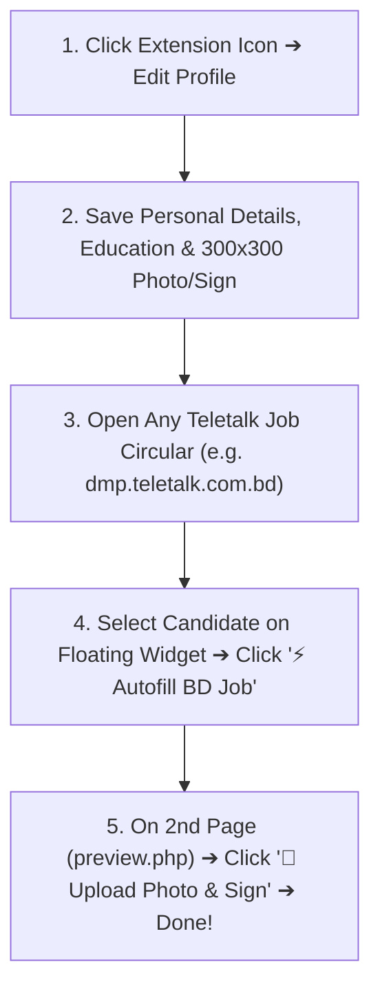

# 🇧🇩 Govt Job Application Chrome Extension (Teletalk Autofill BD)

[](https://developer.chrome.com/docs/extensions/)
[](LICENSE)
[](PRIVACY_POLICY.md)

A fast, lightweight, and 100% privacy-focused browser extension designed to eliminate tedious manual typing on all Bangladesh Government Job Recruitment portals (`*.teletalk.com.bd`). Fill complex multi-page government job applications in **1 click**, manage **multiple candidate profiles** directly on the webpage, and automatically upload resized **300×300 passport photos** and **300×80 signatures**!

---

## 📥 How to Download & Install on Laptop / PC (Step-by-Step)

Anyone can install and run this extension on their computer in under 2 minutes without any programming knowledge:

### Step 1: Download the ZIP File from GitHub
1. Scroll to the top of this GitHub repository page.
2. Click the green **`<> Code`** button located on the top right.
3. Click **`Download ZIP`** from the dropdown menu.  
   *(Direct download link: [Download Repository ZIP](https://github.com/ssllsaiful/Govt_Job_Application_Chrome_Extention/archive/refs/heads/main.zip))*.
4. A zip file named `Govt_Job_Application_Chrome_Extention-main.zip` will download to your computer.

---

### Step 2: Extract (Unzip) the Downloaded File
1. Open your computer's **Downloads** folder.
2. Right-click on `Govt_Job_Application_Chrome_Extention-main.zip` and select **`Extract All...`** (or *Extract Here*).
3. A standard folder named `Govt_Job_Application_Chrome_Extention-main` will be created.  
   *(Tip: Move this folder to your `Documents` or a safe directory so it isn't accidentally deleted later)*.

---

### Step 3: Load the Extension into Google Chrome
1. Open **Google Chrome** on your computer.  
   *(Also works identically on **Brave**, **Microsoft Edge**, and **Opera**)*.
2. In the Chrome address bar (URL bar), type the following and press **Enter**:
   ```text
   chrome://extensions
   ```
   *(For Microsoft Edge, type: `edge://extensions`)*.
3. In the top-right corner of the Extensions page, toggle **`Developer mode`** to **ON**.
4. In the top-left corner, click the **`Load unpacked`** button.
5. In the file picker dialog, browse to and select the extracted folder:  
   `Govt_Job_Application_Chrome_Extention-main`
6. Click **Select Folder**.  
7. Congratulations! The extension **"Teletalk Job Application Autofill BD"** is now installed and active in your browser.

---

### Step 4: Pin the Extension to Chrome Toolbar
1. Click the **Extensions icon (puzzle piece 🧩)** in Chrome's top-right toolbar.
2. Find **"Teletalk Job Application Autofill BD"** in the list.
3. Click the **Pin icon (📌)** next to it so the green icon is always visible in your browser toolbar.

---

## 📖 Complete User Guide



### 1. Setting Up Your Candidate Profile
1. Click the extension icon in your Chrome toolbar and select **✏️ Edit Profile** (or right-click the icon and choose **Options**).
2. A comprehensive dashboard will open:
   - **Personal Info:** Fill in your English Name (Capital letters), Bangla Name (বাংলায়), Father's and Mother's names (English & Bangla), Date of Birth, Gender, Religion, Mobile Number, and National ID / Birth Reg number.
   - **Addresses:** Enter your Present and Permanent address (Care of, Village/Road, District, Upazila/Thana, Post Office, Post Code). Check *"Same as Present Address"* if applicable.
   - **Education:** Enter your SSC, HSC/Diploma, Graduation, and Masters details (Examination, Roll Number, Board, Group/Subject, Result GPA/CGPA, Passing Year, Course Duration).
   - **Other Qualifications:** Select *"Yes"* for Computer Proficiency.
   - **Photo & Sign Tab:** Crop and resize your candidate photo to **300×300 px** and signature to **300×80 px**, then click **Save to Candidate Profile**. *(Strictly exported in official Teletalk JPEG `.jpg` format)*.
3. Click **💾 Save Profile** at the bottom.
4. **Managing Multiple People:** To add family members or friends, click **➕ New Profile** at the top to create independent profiles for each person.

---

### 2. Autofilling a Teletalk Application Form in 1 Click
1. Open any official Bangladesh Teletalk recruitment form (e.g., `dmp.teletalk.com.bd`, `bcic.teletalk.com.bd`, `bcs.teletalk.com.bd`, `bogmc.teletalk.com.bd`).
2. In the bottom-right corner of the webpage, you will see a sleek floating widget:
   $$\text{[ 👤 miLLAT ▾ ]} \quad \text{[ ⚡ Autofill BD Job ]}$$
3. Select your desired candidate from the dropdown (e.g., `MD. SAIFUL ISLAM`, `tareq`, or `miLLAT`).
4. Click **`⚡ Autofill BD Job`** — the entire form will be populated accurately in under 1 second!
5. Verify your information, solve the standard CAPTCHA code, and click **Next / Submit**.
6. On the 2nd page (`preview.php`), the floating button will automatically change to **`📸 Upload Photo & Sign`**.
7. Click **`📸 Upload Photo & Sign`** — the candidate's official 300×300 photo and 300×80 signature will attach automatically to the file inputs, live previews will display, and the declaration checkbox will be checked.
8. Click **Submit Application** to finalize your job application!

---

## 🌟 Key Advantages & Highlights

- **Smart Dependent Dropdowns**: Automatically selects District, waits for Ajax-loaded Upazila/Thana choices, and matches the correct thana even with official database typos (e.g., `Sabujbhag` vs `Sabujghag` vs `Sabujbagdh`).
- **On-Page Multi-Candidate Switcher**: Switch candidate profiles directly from the live webpage without opening popup menus or refreshing the tab.
- **Dedicated Candidate Media Isolation**: Each candidate profile stores their own distinct photo and signature privately.
- **Automatic Question Answering**: Automatically detects questions like *"Do you have Computer proficiency?"* and sets them to **Yes**.
- **100% Offline & Private**: Zero external servers, zero telemetry, and zero tracking. All candidate data stays stored safely on your own computer via Chrome's local storage.

---

## 🔄 How to Update When New Changes Are Released
Whenever a new update is released on this GitHub repository:
1. Download the latest repository ZIP and extract it, replacing the old files in your folder.
2. Go to `chrome://extensions` in your browser.
3. Click the **Reload icon (🔄)** on the extension card. All new updates will apply instantly!

---

## 📂 Project Architecture

```text
├── manifest.json              # Chrome Extension Manifest V3 configuration
├── background.js              # Background service worker
├── content.js                 # In-page floating widget & multi-profile switcher
├── autofill-engine.js         # Core autofill engine, DOM parser & cascading handler
├── site-mappings.js           # Portal selector mappings, regex & dropdown aliases
├── storage.js                 # Multi-profile manager & local storage controller
├── validation.js              # Bangladeshi mobile, DOB & language validators
├── bangladesh-data.js         # Bangladesh district and thana database
├── passport-photo-editor.js   # 300x300 & 300x80 canvas photo & signature editor
├── popup.html / .css / .js    # Toolbar popup interface
├── options.html / .css / .js  # Master candidate profile management dashboard
├── icons/                     # Extension branding icons (16, 48, 128 px)
├── PRIVACY_POLICY.md          # Privacy policy document
└── README.md                  # Complete documentation and user manual
```

---

## 🔒 Privacy Guarantee
Your privacy is our highest priority. All candidate records, passport photos, and signatures remain strictly inside your browser's private local storage (`chrome.storage.local`). For full details, please review our [Privacy Policy](PRIVACY_POLICY.md).

---

## 👨‍💻 Author & Contributions
Developed with ❤️ by **Md. Saiful Islam** ([@ssllsaiful](https://github.com/ssllsaiful)) for all Bangladeshi job seekers.  
Issues, feature suggestions, and pull requests are warmly welcomed!

- **GitHub Profile:** [@ssllsaiful](https://github.com/ssllsaiful)
- **Repository:** [Govt_Job_Application_Chrome_Extention](https://github.com/ssllsaiful/Govt_Job_Application_Chrome_Extention)
- **License:** [MIT License](LICENSE) — 100% Free and Open Source.
