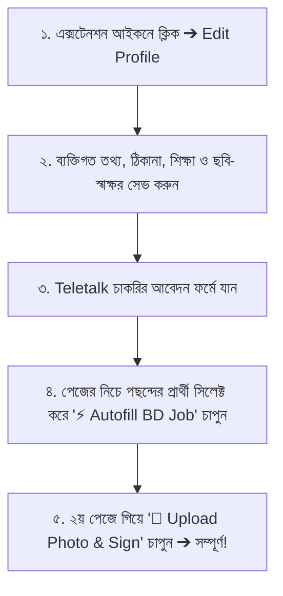

# 🇧🇩 Govt Job Application Chrome Extension (Teletalk Autofill BD)

[](https://developer.chrome.com/docs/extensions/)
[](LICENSE)
[](PRIVACY_POLICY.md)

বাংলাদেশ সরকারি চাকরির আবেদন পোর্টালসমূহে (`*.teletalk.com.bd`) বারবার ম্যানুয়াল টাইপিং ছাড়াই মাত্র **১-ক্লিকে সম্পূর্ণ ফর্ম পূরণ**, একাধিক প্রার্থীর প্রোফাইল নির্বাচন এবং স্বয়ংক্রিয়ভাবে **৩০০×৩০০ পাসপোর্ট ছবি** ও **৩০০×৮০ স্বাক্ষর** আপলোড করার সম্পূর্ণ ফ্রি ও অফলাইন ক্রোম এক্সটেনশন।

---

## 📥 গিটহাব থেকে ডাউনলোড ও ল্যাপটপ/পিসিতে সেটআপ করার সহজ নিয়ম (Step-by-Step Guide)

যেকোনো সাধারণ ব্যবহারকারী কোনো কোডিং জ্ঞান ছাড়াই মাত্র ২ মিনিটে এটি নিজের ক্রোম ব্রাউজারে যুক্ত করে ব্যবহার করতে পারবেন:

### ধাপ ১: গিটহাব থেকে জিপ ফাইল ডাউনলোড করুন
1. এই GitHub পেজের উপরের ডান দিকে থাকা সবুজ রঙের **`<> Code`** বাটনে ক্লিক করুন।
2. মেনু থেকে **`Download ZIP`** এ ক্লিক করুন।  
   *(সরাসরি ডাউনলোড করতে [এখানে ক্লিক করুন](https://github.com/ssllsaiful/Govt_Job_Application_Chrome_Extention/archive/refs/heads/main.zip))*
3. আপনার কম্পিউটারে একটি জিপ ফাইল (`Govt_Job_Application_Chrome_Extention-main.zip`) ডাউনলোড হবে।

---

### ধাপ ২: ফাইলটি আনজিপ (Extract) করুন
1. আপনার কম্পিউটারের **Downloads** ফোল্ডারে যান।
2. ডাউনলোড করা ফাইলটির উপর মাউসের ডান ক্লিক (Right Click) করে **`Extract All...`** (বা Extract Here) এ ক্লিক করুন।
3. একটি সাধারণ ফোল্ডার তৈরি হবে (যেমন: `Govt_Job_Application_Chrome_Extention-main`)।  
   *(ফোল্ডারটি এমন জায়গায় রাখুন যেখান থেকে পরবর্তীতে ভুলবশত ডিলিট না হয়ে যায়, যেমন: Documents ফোল্ডারে)*।

---

### ধাপ ৩: গুগল ক্রোমে এক্সটেনশন যুক্ত করুন
1. আপনার কম্পিউটারে **Google Chrome** ব্রাউজার খুলুন।  
   *(এটি Brave, Microsoft Edge বা Opera ব্রাউজারেও একইভাবে কাজ করে)*।
2. ব্রাউজারের অ্যাড্রেস বারে নিচের লেখাটি লিখে **Enter** চাপুন:
   ```text
   chrome://extensions
   ```
   *(Edge ব্রাউজারের জন্য: `edge://extensions`)*
3. পেজের উপরের ডান কোণায় থাকা **`Developer mode`** টগল বাটনটি চালু (ON) করুন।
4. এবার পেজের উপরের বাম কোণায় একটি নতুন বাটন দেখতে পাবেন: **`Load unpacked`** — এটিতে ক্লিক করুন।
5. একটি উইন্ডো আসবে; সেখান থেকে ধাপ ২-এ আনজিপ করা মূল ফোল্ডারটি (`Govt_Job_Application_Chrome_Extention-main`) সিলেক্ট করে **Select Folder** বাটনে চাপ দিন।
6. ব্যাস! এক্সটেনশনটি সাথে সাথে আপনার ব্রাউজারে ইনস্টল হয়ে যাবে।

---

### ধাপ ৪: এক্সটেনশনটি পিন (Pin) করুন
1. ক্রোম ব্রাউজারের উপরে ডান পাশে এক্সটেনশন আইকনে (পাজল চিহ্ন 🧩) ক্লিক করুন।
2. তালিকায় **"Teletalk Job Application Autofill BD"** এর পাশে থাকা **Pin (📌)** আইকনে ক্লিক করুন।
3. এখন থেকে ব্রাউজারের উপরে এক্সটেনশনের সবুজ রঙের লোগোটি সবসময় দেখতে পাবেন।

---

## 📝 কীভাবে নিজের তথ্য সেভ ও ব্যবহার করবেন (User Guide)



### ১. আপনার প্রোফাইল তৈরি করুন:
1. ব্রাউজারের উপরে এক্সটেনশন আইকনে ক্লিক করে **✏️ Edit Profile** এ চাপুন (অথবা আইকনে রাইট ক্লিক করে **Options** সিলেক্ট করুন)।
2. একটি সুন্দর ড্যাশবোর্ড খুলবে:
   - **Personal Info:** আপনার ইংরেজি নাম (বড় হাতের), বাংলা নাম (বাংলায়), পিতা-মাতার নাম, জন্ম তারিখ, ধর্ম, মোবাইল নম্বর ও জাতীয় পরিচয়পত্র (NID) নম্বর দিন।
   - **Addresses:** বর্তমান ও স্থায়ী ঠিকানা নির্বাচন করুন (প্রয়োজনে "Same as Present Address" টিক দিন)।
   - **Education:** SSC, HSC/Diploma, Graduation এবং Masters-এর তথ্য দিন (রোল, বোর্ড, গ্রুপ, রেজাল্ট CGPA, পাসের সাল ইত্যাদি)।
   - **Other Qualifications:** "Computer Proficiency" তে Yes সিলেক্ট রাখুন।
   - **Photo & Sign:** এখানে আপনার পাসপোর্ট ছবি এবং স্বাক্ষর ক্রপ করেTeletalk-এর নিয়ম অনুযায়ী সাইজ করে **Save to Candidate Profile** বাটনে চাপ দিন।
3. নিচে থাকা **💾 Save Profile** বাটনে ক্লিক করুন।
4. আপনি চাইলে একাধিক প্রার্থীর তথ্য (যেমন নিজের, ভাইয়ের বা বন্ধুর) রাখতে উপরে থাকা **➕ New Profile** দিয়ে নতুন প্রোফাইল তৈরি করতে পারবেন।

---

### ২. চাকরির ফর্মে এক ক্লিকে আবেদন করুন:
1. যেকোনো Teletalk চাকরির নিয়োগ ফর্মে যান (যেমন: `dmp.teletalk.com.bd`, `bcic.teletalk.com.bd`, `bcs.teletalk.com.bd`, `bogmc.teletalk.com.bd` ইত্যাদি)।
2. আবেদন পেজের নিচের ডান কোণায় একটি সবুজ ফ্লোটিং উইজেট দেখতে পাবেন:
   $$\text{[ 👤 miLLAT ▾ ]} \quad \text{[ ⚡ Autofill BD Job ]}$$
3. ড্রপডাউন থেকে যার নামে আবেদন করতে চান তাকে সিলেক্ট করুন (যেমন: `MD. SAIFUL ISLAM`, `tareq` অথবা `miLLAT`)।
4. **`⚡ Autofill BD Job`** বাটনে ক্লিক করুন — মাত্র ১ সেকেন্ডে পুরো ফর্মটি নিখুঁতভাবে পূরণ হয়ে যাবে!
5. তথ্যগুলো একবার চোখ বুলিয়ে দেখে ক্যাপচা (Verification Code) টাইপ করে **Next** চাপুন।
6. ২য় পেজে (প্রিভিউ পেজ) আসলেই ফ্লোটিং বাটনটি স্বয়ংক্রিয়ভাবে **`📸 Upload Photo & Sign`** হয়ে যাবে।
7. বাটনটিতে ক্লিক করলেই প্রার্থীর অফিসিয়াল ৩০০×৩০০ ছবি ও ৩০০×৮০ স্বাক্ষর আপলোড হয়ে যাবে এবং নিচের ঘোষণাপত্রের বক্সে টিক পড়ে যাবে।
8. **Submit Application** দিয়ে আপনার আবেদন সম্পন্ন করুন!

---

## 🌟 এই এক্সটেনশনের বিশেষত্ব

- **১০০% নির্ভুল ড্রপডাউন সিঙ্ক:** জেলা সিলেক্ট করার পর স্বয়ংক্রিয়ভাবে থানা/উপজেলা লোড হওয়া পর্যন্ত অপেক্ষা করে থানা সিলেক্ট করে। Teletalk-এর অফিশিয়াল ডাটাবেজে থাকা বানান ভুলও (যেমন: *Sabujbhag / Sabujghag*) এটি নিজে থেকেই শুধরে নেয়।
- **অন-পেজ মাল্টি-প্রোফাইল সুইচার:** একই ল্যাপটপ থেকে পরিবারের একাধিক সদস্য বা ক্লায়েন্টের জন্য পেজ রিফ্রেশ না করেই ক্যান্ডিডেট পরিবর্তন করে আবেদন করা যায়।
- **কম্পিউটার প্রফিসিয়েন্সি অটো-ম্যাচ:** *"Do you have Computer proficiency?"* প্রশ্নটিতে স্বয়ংক্রিয়ভাবে Yes সিলেক্ট হয়।
- **সম্পূর্ণ নিরাপদ ও প্রাইভেট:** কোনো প্রকার রিমোট সার্ভার নেই, কোনো ট্র্যাকিং নেই। আপনার যাবতীয় তথ্য ও ছবি কেবল আপনার ল্যাপটপের ব্রাউজারে নিরাপদেই জমা থাকে।

---

## 🔄 পরবর্তীতে নতুন আপডেট নেওয়ার নিয়ম
ভবিষ্যতে যদি এই এক্সটেনশনে নতুন কোনো আপডেট আসে:
1. গিটহাব থেকে নতুন জিপ ফাইলটি ডাউনলোড করে আগের ফোল্ডারে রিপ্লেস (Replace) করুন।
2. `chrome://extensions` পেজে গিয়ে এক্সটেনশনটির পাশে থাকা **Reload (🔄)** বাটনে একটি ক্লিক করলেই নতুন ফিচারগুলো আপডেট হয়ে যাবে।

---

## 👨‍💻 ডেভলপার ও লাইসেন্স
- **Developer:** Md. Saiful Islam ([@ssllsaiful](https://github.com/ssllsaiful))
- **Source Code:** [Govt_Job_Application_Chrome_Extention](https://github.com/ssllsaiful/Govt_Job_Application_Chrome_Extention)
- **License:** MIT License — সম্পূর্ণ ফ্রি এবং যেকোনো চাকরিপ্রার্থী ব্যবহারের জন্য উন্মুক্ত।
