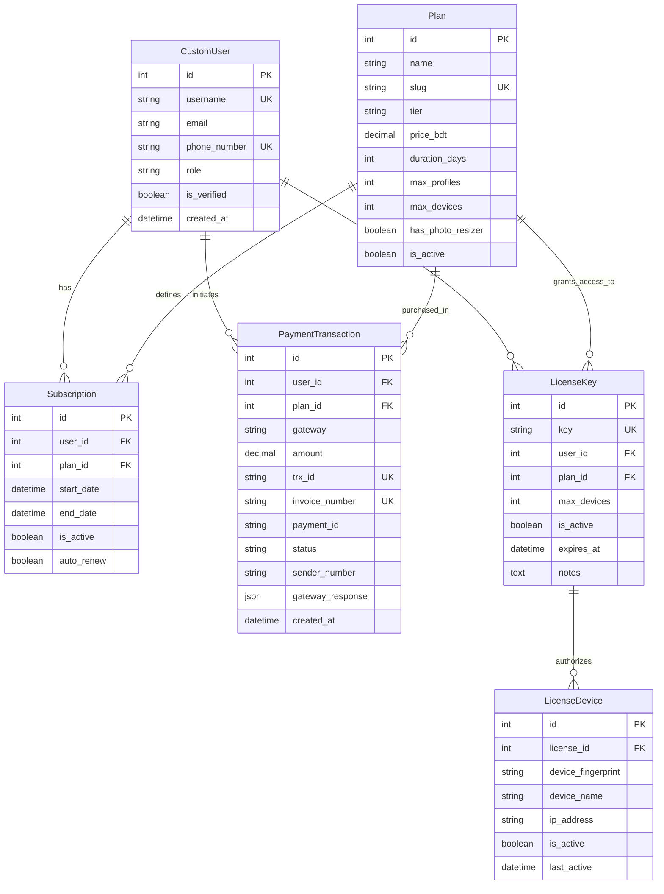

# Database Schema & Entity Relationships

The backend uses a relational data model with PostgreSQL (production) or SQLite3 (local development).

## Entity Relationship Overview

## Indexes
- `PaymentTransaction.trx_id`: Unique index for bKash/Nagad instant verification.
- `PaymentTransaction.invoice_number`: Unique index for gateway tracking.
- `LicenseKey.key`: Unique B-Tree index for sub-millisecond client validation.
- `LicenseDevice.(license, device_fingerprint)`: Composite unique constraint preventing duplicate device activations.
